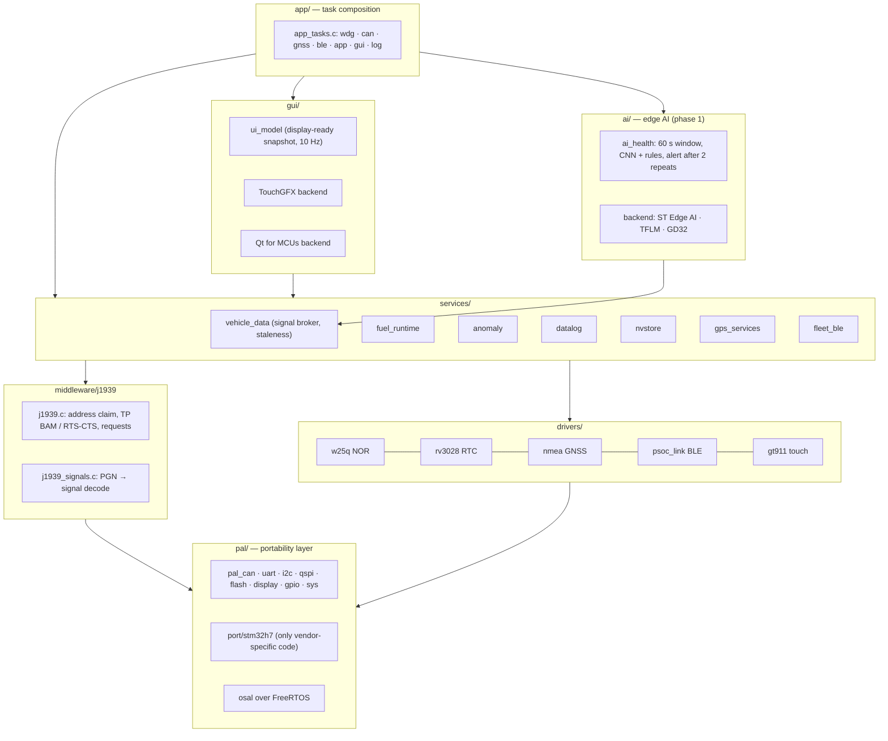
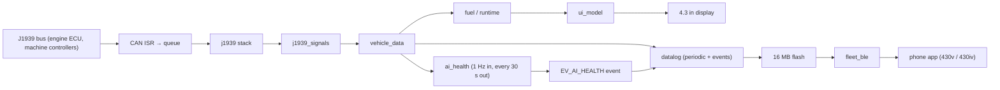

# Firmware architecture 1: maxAI 430 (as built today)

This is the map of the current firmware (`firmware/mower-hmi`) placed on the **maxAI 430**
hardware. One engine type, one J1939 signal set, one edge-AI model. Firmware architecture 2
(`firmware_architecture_2.md`) extends it to every Bad Boy and Hustler mower.

> The code base was first written against a 7-inch reference board (`config/board_config.h`:
> 32 MB SDRAM, 64 MB NOR, touch panel). The maxAI 430 is smaller. Section 5 lists what has to
> change before the image fits the 430. Items marked **VERIFY** are not published by maximatecc.

## 1. Hardware the firmware runs on

| Item | maxAI 430 (datasheet) | Reference board in `board_config.h` | Impact |
|---|---|---|---|
| MCU | Arm Cortex-M7, part not published (**VERIFY**; assumed STM32H743 class) | STM32H743 at 400 MHz | none if it is an H743 |
| Internal RAM / flash | 1 MB / 2 MB | 1 MB / 2 MB | none |
| External SDRAM | **2 MB** | 32 MB | memory map must shrink (section 5) |
| External flash | **16 MB** | 64 MB | log ring and asset area shrink |
| Display | 4.3 in, 480×272, 24-bit, 1000 nit | 7 in, 800×480, touch | GUI layouts, input method (**VERIFY** keys vs touch) |
| CAN | 2 × J1939, 250 / 500 kbit/s | 1 bus used | second bus available for implement / machine controllers |
| Inputs | 5 inputs + 4–20 mA, 1 output | not used | used by architecture 2 for machines without an ECU |
| Bluetooth | BT 4.2 on 430v / 430iv | PSoC 4 BLE over UART | module and link (**VERIFY**) |
| Camera | analog camera input on 430v / 430iv | none | budget in `tools/resource_budget` |
| GNSS / RTC | not listed (**VERIFY**) | u-blox M10, RV-3028 | GPS features need an external receiver or the phone |

## 2. Layers

Rules carried from `docs/architecture.md`: `pal_` prefix, logical resources only, no vendor
header above the PAL port, no GUI calls from app code, host build in CI (`make -C tests`).

## 3. Data flow on the 430

## 4. Tasks (FreeRTOS)

| Task | Priority | Period / trigger | Owns |
|---|---|---|---|
| wdg | 7 | 500 ms | watchdog, kicks only if every task checked in |
| can | 6 | RX queue / 20 ms | J1939 stack, signal decode |
| gnss | 5 | UART | NMEA, geofences, coverage (needs a receiver on the 430) |
| ble | 4 | UART / 20 ms | phone link, log streaming (430v / 430iv) |
| app | 4 | 100 ms, 1 Hz logic | fuel / runtime, anomaly, **ai_health**, logging policy, UI model |
| gui | 3 | vsync | TouchGFX or Qt for MCUs |
| log | 2 | queue | only writer of the external flash log |
| ai (planned) | 1 | 30 s | runs the backend inference below the GUI, per `tools/resource_budget` rule R3 |

## 5. What must change to fit the maxAI 430

| Area | Today | maxAI 430 plan |
|---|---|---|
| Frame buffers | 2 × 750 KB (800×480 RGB565) | 2 × 255 KB (480×272 RGB565) |
| GUI bitmap cache | 16 MB in SDRAM | about 300 KB: alarm screens and fonts only; other assets stay in flash |
| Coverage grid (`COV_DIM 4096`, 0.25 m) | 2 MB in SDRAM | 0.5 m cells, 2048² → 512 KB, or move coverage to the phone |
| Log ring | 44 MB | about 10 MB; record rate unchanged |
| Firmware staging | 4 MB | 2 MB |
| Bitmaps | 16 MB, cached at boot | 4 MB; flash erase must never block alarm screens (budget rule R4/R5) |
| Inputs | touch (GT911) | **VERIFY**: keys or touch on the 430 |
| MPU region for SDRAM | 32 MB | 2 MB |

SDRAM on the 430 after these changes: 510 KB frame buffers + 255 KB transition snapshot + 300 KB
alarm cache + 512 KB coverage (+ 338 KB camera on 430v / 430iv) ≈ 1.9 MB of 2 MB. Tight but it fits.
Dropping the coverage grid from the display frees a quarter of it.

## 6. J1939 signals (architecture 1)

| PGN | SPN | Signal | Used by |
|---|---|---|---|
| 61444 EEC1 | 190 | engine speed | UI, fuel, AI |
| 61443 EEC2 | 92 | load | AI, anomaly |
| 65262 ET1 | 110 | coolant temperature | UI, AI (clogged screen) |
| 65263 EFL/P1 | 100 | oil pressure | UI, AI (low oil) |
| 65266 LFE1 | 183 | fuel rate | fuel / runtime, AI |
| 65276 DD1 | 96 | fuel level | fuel / runtime |
| 65253 HOURS | 247 | engine hours (on request) | service |
| 65271 VEP1 | 168 | battery | UI |
| 65265 CCVS1 | 84 | wheel speed | AI, overspeed |
| 65128 VF | 1638 | hydraulic oil temperature | AI |
| 65269 AMB | 171 | ambient temperature | AI |
| 65226 DM1 | — | active faults, lamps | UI, log |
| 0xFF10 | — | blade clutch, deck height (OEM placeholder) | AI, coverage |

## 7. Edge AI in architecture 1

- One model: int8 1-D CNN on 60 s × 9 features, trained on a **liquid-cooled** synthetic machine
  (`tools/edge_ai_poc`). It runs as the hybrid with rules; macro-F1 0.960 on synthetic data.
- Every feature must exist. A machine with no coolant SPN never completes a window, so the AI
  stays silent on every air-cooled EFI and carbureted mower. That limit is why architecture 2 exists.
- Backend: ST Edge AI (default on the H743), TFLite Micro reference, GD32 path.
