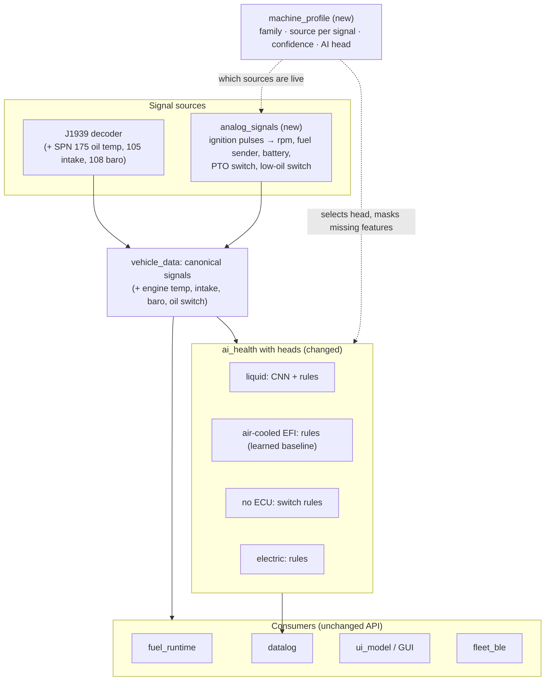
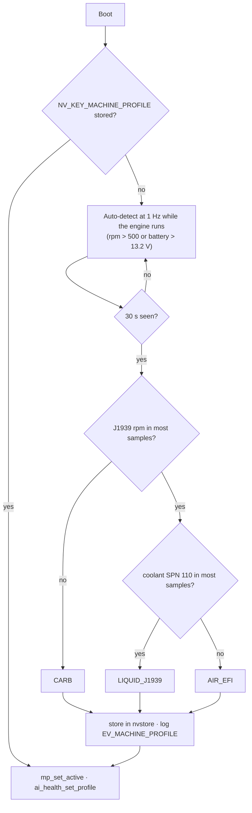

# Firmware architecture 2: one firmware for every Bad Boy and Hustler mower

Architecture 1 assumes one engine with one J1939 signal set. The fleet review
(`docs/fleet-expansion/` at the repository root) found:

- most units sold are **carbureted**: no ECU, no J1939
- every EFI engine in both lineups is **air-cooled**: no coolant temperature
- the E-Magnum is **electric**, with an 80 V battery system

Architecture 2 adds a **machine profile layer** between the signal sources and everything that
uses signals. The same image runs on every model. The profile says which signals exist, where
each one comes from, and which edge-AI head applies.

## 1. What is new

| Module | File | Role |
|---|---|---|
| Machine profile | `services/machine_profile.{h,c}` | 9 families, source and confidence per signal, AI head, auto-detect |
| Analog signals | `services/analog_signals.{h,c}` | raw display inputs → canonical signals on machines without an ECU |
| PAL analog API | `pal/include/pal_analog.h` | `pal_analog_sample()`; weak default until the STM32H7 port implements it |
| Canonical signals | `services/vehicle_data.h` | adds `VD_ENGINE_TEMP_C` (SPN 175), `VD_INTAKE_C` (SPN 105), `VD_BARO_KPA` (SPN 108), `VD_OIL_LOW_SW` |
| J1939 decode | `middleware/j1939/j1939_signals.c` | ET1 SPN 175, IC1 SPN 105, AMB SPN 108 |
| Edge AI | `ai/ai_health.{h,c}` | `ai_health_set_profile()`, feature mask, per-head rules, `ai_aux_t` |
| App | `app/app_tasks.c` | samples inputs, runs auto-detect, stores the profile, feeds AI aux signals |
| Storage | `services/nvstore.h` | `NV_KEY_MACHINE_PROFILE` |
| Log | `services/datalog.h` | `EV_MACHINE_PROFILE` (family, auto or stored) |

## 2. Profiles

| Family | Fleet examples | ECU | Cooling | AI head | Thermal signal |
|---|---|---|---|---|---|
| `LIQUID_J1939` | phase 1 synthetic machine | yes | liquid | liquid (CNN + rules) | coolant SPN 110 |
| `KAW_FX_EFI` | Rogue, Revolt, Super Z, HyperDrive | yes | air | air-cooled EFI | oil temp SPN 175 |
| `KAW_EVO_EFI` | Rebel, Revolt | yes (J1939 **VERIFY**) | air | air-cooled EFI | oil temp SPN 175 |
| `VAN_EFI_ETC` | Rogue, Rebel X, Maverick HD, HyperDrive | yes | air | air-cooled EFI | oil temp SPN 175 |
| `KOH_EFI` | Rogue | yes (J1939 **VERIFY**) | air | air-cooled EFI | oil temp SPN 175 |
| `PERKINS_1100` | Renegade Diesel | **VERIFY** | liquid | liquid | coolant SPN 110 |
| `AIR_EFI` | auto-detect result, make not set | yes | air | air-cooled EFI | oil temp SPN 175 |
| `CARB` | MZ, ZT, Maverick, Raptor, FasTrak… | no | air | no ECU | none |
| `EV_80V` | E-Magnum | **VERIFY** | — | electric | none |

Every signal in a profile also carries a confidence (`confirmed`, `inferred`, `verify`) taken
from `docs/fleet-expansion/fleet_profiles.json`. Roadmap phase 0 (bench CAN logs, one machine
per family) replaces the `verify` entries.

## 3. How a machine gets its profile

- Auto-detect tells the classes apart. It cannot name the engine make, and it cannot detect
  electric. The dealer sets the exact family at install. A later step can read the make from the
  engine's J1939 NAME once the manufacturer codes are mapped.
- Battery voltage is read from the analog input before any profile exists, so a machine with no
  ECU can still be seen running (charging voltage).

## 4. Edge-AI heads

| Head | Model | Rules | Status |
|---|---|---|---|
| Liquid | int8 CNN, phase 1 | low oil (pressure), clogged screen (coolant > 95 °C), hydraulic > 90 °C | trained, macro-F1 0.960 hybrid |
| Air-cooled EFI | not trained yet | low oil (pressure or switch); clogged screen when oil temp rises **5 °C above this machine's learned baseline** with blades on; hydraulic | rules only |
| No ECU | not trained yet | low oil from the switch above 1500 rpm | rules only |
| Electric | — | none for the engine; battery and runtime come from the pack data | rules only |

Features a profile marks as not fitted are filled with the training mean (0 after
normalisation) and never block a window. On architecture 1 they blocked it forever.

**Why a learned baseline on air-cooled engines.** There is no thermostat, and the working oil
temperature depends on the engine, the weather and the machine. A fixed 130 °C threshold never
fired on the synthetic fleet. A rise of 5 °C over the machine's own baseline (learned over 30 min
of mowing, frozen while a clog alert is active, armed after 10 min) scored best offline. The
baseline is held in RAM and relearned after each power-up.

## 5. Synthetic fleet data (generator 0.2.0)

`tools/mower_j1939_synth/config_fleet.json` generates 6 machines across three families:
`liquid_j1939`, `air_efi` and `carb`. The physics are shared and only the display's view changes.
`windows.npz` gains `mask` (which features exist), `aux` (oil temperature, oil switch) and
`family`. `validate.py --firmware` passes on both the default and the fleet configuration.
Air-cooled CAN logs replay through the firmware with no coolant temperature, and oil temperature
matches to 0.01 °C.

Offline results on the fleet data (rules only, last sample of each 60 s window):

| Family | Rule | F1 | Note |
|---|---|---|---|
| liquid | clog, coolant > 95 °C | 0.75 | reference |
| air-cooled EFI | clog, fixed 130 °C | 0.00 | never fires |
| air-cooled EFI | clog, baseline + 5 °C | 0.40 | needs the trained air head (phase 2) for more |
| carb | low oil, pressure switch | 0.13 | precision 1.0, but the switch is closed for only 6 % of the low-oil time |
| carb | clogged screen | — | not observable without a temperature |

The carbureted numbers matter for the product. A pressure switch catches only the last stage of
an oil loss, and nothing on these engines shows a clogged screen. That makes the BLE health tag
(vibration, ignition pulses) and service reminders the value on Tier 3 machines, not engine
diagnostics.

## 6. Hardware tiers on this firmware

| Tier | Hardware | Profiles | What runs |
|---|---|---|---|
| T1 | maxAI 430 / 430v | ECU families | everything above, liquid or air-cooled head |
| T2 | maxAI 280 or a box with no screen | `CARB` on commercial models | analog inputs, no-ECU head, hours and service, BLE |
| T3 | BLE health tag (new hardware) | `CARB` residential | separate small firmware: IMU vibration model, pulses, battery |
| T4 | tag or pack bridge | `EV_80V` | pack state, runtime |

## 7. Open items

| Item | Owner | Blocks |
|---|---|---|
| Bench CAN logs, one per family (7) | integration | replacing `verify` in profiles and JSON |
| maxAI 430 fitment list from Bad Boy | product | Tier 1 rollout |
| `pal_analog_sample()` in the STM32H7 port, pin map on the 430 inputs | firmware | Tier 2 on hardware |
| Pulses per revolution per carb engine | integration | analog rpm accuracy |
| Train air-cooled and no-ECU heads on `config_fleet.json` with masks | data science | AI beyond rules on those families |
| Map J1939 NAME manufacturer codes to families | integration | auto-detect naming the make |
| Persist the air-cooled baseline across power cycles | firmware | faster arming after key-on |
| Hustler profiles after the deal closes | integration, legal | Hustler rollout |
